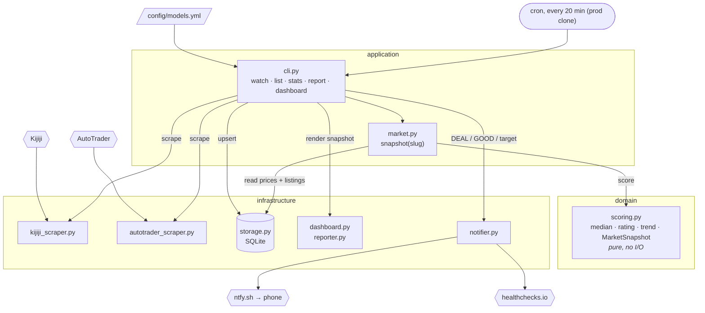

# dirtbike-tracker

Personal used dirt bike price tracker. Scrapes Kijiji and AutoTrader for the models in
`config/models.yml`, stores listings in SQLite, rates each one against the model's 90-day
market median, and pushes DEAL/GOOD/target-price alerts to your phone via [ntfy](https://ntfy.sh).

## How it works



Every 20 minutes `watch` scrapes each model in `config/models.yml`, upserts listings into
SQLite, scores them against the market via `snapshot()`, alerts on new DEAL/GOOD/target
listings, and rebuilds `dashboard.html`. The domain layer is pure: it receives prices and
listings, never queries.

Ratings are price vs market median: **DEAL** ≤ -30%, **GOOD** ≤ -10%, **FAIR** ≤ +15%,
**HIGH** above that. A listing under a model's `target_price` alerts regardless of market.

Layout is hexagonal (`src/dirtbike_tracker/{domain,infrastructure,application}`). See
[docs/architecture.md](docs/architecture.md) for modules, data model, dedup and scoring.

## Usage

```bash
dirtbike models                      # tracked models from config/models.yml
dirtbike watch                       # scrape all, score, notify, rebuild dashboard
dirtbike watch --no-notify --group priority
dirtbike scrape --model crf150f --source all
dirtbike list --model crf150f        # stored listings with ratings
dirtbike stats --model crf150f       # low / median / high / count
dirtbike report --model crf150f --write   # markdown snapshot to reports/
dirtbike dashboard --open
```

Add or remove models in `config/models.yml`. Valid Kijiji slugs live in
`infrastructure/kijiji_scraper.py:KNOWN_MODEL_SLUGS`.

### Environment

| Var | Purpose |
|---|---|
| `NTFY_TOPIC` | ntfy topic to push alerts to. Required unless `--no-notify`. |
| `NTFY_SERVER` | Defaults to `https://ntfy.sh`. |
| `HEALTHCHECK_URL` | Optional. [healthchecks.io](https://healthchecks.io) ping URL hit after every completed `watch`; it alerts when pings stop. |
| `ANTHROPIC_API_KEY` | Optional. Enables LLM fact extraction (year, hours). |

### Cron

Cron runs from a separate **prod clone** that stays on `main`, so a feature branch
checked out in the dev repo never goes live. Both share the dev repo's `data/`
(DB + notified state) and `dashboard.html`.

```bash
# one-time setup
git clone https://github.com/adamkwhite/dirtbike-tracker.git ~/Code/dirtbike-tracker-prod
cd ~/Code/dirtbike-tracker-prod
python3.13 -m venv venv && venv/bin/pip install -e .
ln -s ~/Code/dirtbike-tracker/data data
ln -s ~/Code/dirtbike-tracker/dashboard.html dashboard.html
NTFY_TOPIC=your-topic HEALTHCHECK_URL=https://hc-ping.com/<uuid> ./scripts/install_cron.sh   # every 20 min, 6am-11pm

# deploy after merging to main
git -C ~/Code/dirtbike-tracker-prod pull --ff-only

# uninstall
~/Code/dirtbike-tracker-prod/scripts/install_cron.sh --remove
```

Logs go to `~/Code/dirtbike-tracker-prod/logs/watch.log` (timestamped if `moreutils` is installed).

## Requirements

- Python 3.13+

## Development

### 1. Install Dependencies

```bash
# Create and activate virtual environment
python3.13 -m venv venv
source venv/bin/activate  # On Windows: venv\Scripts\activate

# Install project dependencies
pip install -r requirements.txt

# Install development dependencies
pip install -e ".[dev]"
```

### 2. Set Up Pre-commit Hooks (Required)

Pre-commit hooks automatically format and lint your code before each commit, ensuring code quality.

```bash
# Install pre-commit
pip install pre-commit

# Enable pre-commit hooks
pre-commit install

# (Optional) Run against all files to test
pre-commit run --all-files
```

**What pre-commit does:**
- Auto-fixes formatting issues with Ruff
- Sorts imports automatically
- Removes trailing whitespace
- Validates YAML/JSON files
- Type checks with mypy
- Security scans with Bandit

**Your workflow:**
1. Write code (Claude or manual)
2. Run `git commit`
3. Pre-commit auto-fixes formatting
4. Commit succeeds with clean code

### 3. Tests

```bash
pytest tests/ --cov=src
```

CI runs pre-commit, pytest and SonarCloud on every push and PR.

### Exception Handling & `noqa` Conventions

Ruff enforces `BLE` (blind-except), `TRY` (tryceratops), `LOG`, and `G` (logging-format) rules. Broad `except Exception` blocks fail CI by default.

When a broad catch is intentional and the handler logs or re-raises, suppress with a plain noqa:

```python
except Exception:  # noqa: BLE001
    logger.exception("failed to process item")
```

When the broad catch is real debt that swallows silently, tag it as a FIXME:

```python
except Exception:  # noqa: BLE001  # FIXME: blind catch, tighten + log
    pass
```

Grep the FIXME tag to get the live backlog count:

```bash
grep -rn 'FIXME: blind catch' src/
```

Do not add blanket per-file `BLE` ignores for whole directories. Each suppression is inline so a real silent swallow can't hide behind a directory-wide glob.
