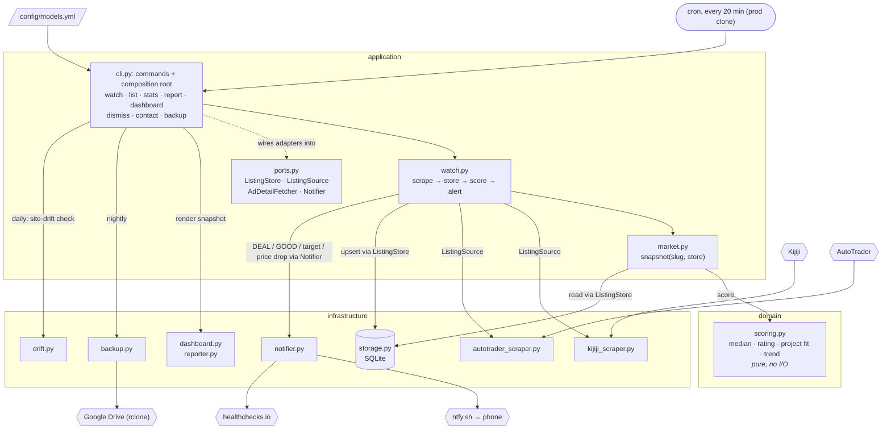

# dirtbike-tracker

Finds a **project bike** to wrench on with the kids: a used dirt bike that needs work, priced
right, with ownership. Scrapes Kijiji and AutoTrader for the models in `config/models.yml`,
stores listings in SQLite, rates each one against the model's 90-day market median, scores its
project fit, and pushes alerts to your phone via [ntfy](https://ntfy.sh).

## How it works



Every 20 minutes `watch` scrapes each model in `config/models.yml`, upserts listings into
SQLite, scores them via `snapshot()`, alerts on new DEAL/GOOD/target listings and on price
drops into GOOD/DEAL, and rebuilds `dashboard.html`. The domain layer is pure: it receives prices and
listings, never queries.

Ratings are price vs market median: **DEAL** ≤ -30%, **GOOD** ≤ -10%, **FAIR** ≤ +15%,
**HIGH** above that. A listing under a model's `target_price` alerts regardless of market.

**Fit** (0-10, neutral 5) scores whether it's a good **project bike** to wrench on with kids, from
phrases in the title/description: +2 per green flag (`doesn't run`, `needs work`, `project`,
`ownership`, `trail`, ...), -3 per red flag (`no ownership`, `seized`, `blown`, `race bike`).
Needing work is the point; "runs great" is neutral. Lists live in `domain/scoring.py`. A listing
with fit below 5 never alerts, however cheap.

A model with `goal: ride` in `models.yml` (e.g. the Rebel 500, to ride in spring) flips that:
needing work, `no safety` and `sold as is` are red flags, and `runs great`, `safetied`,
`certified`, `low kms`, `new tires` are green. Ride models have no project-bike median.
Adding a model: an entry in `models.yml` (plus its slug in `KNOWN_MODEL_SLUGS`), and if
AutoTrader's keyword search misses the slug, a spelling in `autotrader_scraper.KEYWORDS`.
Run `dirtbike watch --group <group> --no-notify` once after deploying, or every listing
already on the market alerts as new.

Kijiji search pages carry a ~200-char snippet of every ad; a snippet that isn't cut off is the
whole ad. For a cut-off one that could alert (DEAL/GOOD or under target), `watch` reads the full
ad (up to 5 per model, once each) and re-scores fit on it. A red flag in the body stops the alert.

**Project bikes** (a condition phrase: `doesn't run`, `needs work`, `needs rings`, `project`, ...)
are rated against the median of other project bikes, since next to running bikes a non-runner
looks like a DEAL just for not running. Until a model has 5 project prices in 90 days they fall
back to the all-bikes median, shown as `vs all bikes*` (dashboard `-40%*`).

Layout is hexagonal (`src/dirtbike_tracker/{domain,infrastructure,application}`). See
[docs/architecture.md](docs/architecture.md) for modules, data model, dedup and scoring.

## Usage

```bash
dirtbike models                      # tracked models from config/models.yml
dirtbike watch                       # scrape all, score, notify, rebuild dashboard
dirtbike watch --no-notify --group priority
dirtbike scrape --model crf150f --source all
dirtbike list --model crf150f        # stored listings with ratings
dirtbike stats --model crf150f       # low / median / high / count
dirtbike report --model crf150f --write   # markdown snapshot to reports/
dirtbike dashboard --open
dirtbike dismiss <url-or-id>         # hide a listing you've evaluated (survives re-scrapes)
dirtbike undismiss <url-or-id>
dirtbike contact <url-or-id> --note "offered 750" [--on 2026-10-01]  # log messaging a seller (--clear to undo)
dirtbike backup [--slot weekly]      # DB + state to Google Drive (see Backups)
dirtbike drift [--replay] [--no-notify]   # site-drift check (see Site drift)
```

Add or remove models in `config/models.yml`. Valid Kijiji slugs live in
`infrastructure/kijiji_scraper.py:KNOWN_MODEL_SLUGS`.

### Environment

| Var | Purpose |
|---|---|
| `NTFY_TOPIC` | ntfy topic to push alerts to. Required unless `--no-notify`. |
| `NTFY_SERVER` | Defaults to `https://ntfy.sh`. |
| `HEALTHCHECK_URL` | Optional. [healthchecks.io](https://healthchecks.io) ping URL hit after every completed `watch`; it alerts when pings stop. |

### Cron

Cron runs from a separate **prod clone** that stays on `main`, so a feature branch
checked out in the dev repo never goes live. The prod clone owns the live data: its own
`data/` (DB + notified state) and `dashboard.html`. The dev repo has a separate `data/`, so a
command run in dev (which runs `init_db()` and its schema migrations) never touches prod. To
work on fresh data in dev, copy prod's over between cron ticks:
`cp ~/Code/dirtbike-tracker-prod/data/listings.db ~/Code/dirtbike-tracker/data/`.

```bash
# one-time setup
git clone https://github.com/adamkwhite/dirtbike-tracker.git ~/Code/dirtbike-tracker-prod
cd ~/Code/dirtbike-tracker-prod
python3.13 -m venv venv && venv/bin/pip install -e .
NTFY_TOPIC=your-topic HEALTHCHECK_URL=https://hc-ping.com/<uuid> ./scripts/install_cron.sh   # every 20 min, 6am-11pm

# deploy after merging to main
git -C ~/Code/dirtbike-tracker-prod pull --ff-only

# uninstall
~/Code/dirtbike-tracker-prod/scripts/install_cron.sh --remove
```

`install_cron.sh` installs five jobs (Ontario time):

| When | Job | Log |
|---|---|---|
| every 20 min, 6:00–23:40 | `dirtbike watch` | `logs/watch.log` |
| 23:30 daily | `dirtbike report --model crf150f --write` | `logs/report.log` |
| 23:55 daily, 23:58 Sundays | `dirtbike backup` (nightly / `--slot weekly`) | `logs/backup.log` |
| 05:00 daily | `dirtbike drift` (see Site drift) | `logs/drift.log` |

Logs are in `~/Code/dirtbike-tracker-prod/logs/` (timestamped if `moreutils` is installed). After
changing the schedule in `install_cron.sh`, re-run it from the prod clone with the same
`NTFY_TOPIC` / `HEALTHCHECK_URL`: it replaces every `# dirtbike-tracker` line.

### Docker

An alternative to the WSL cron, e.g. for a VPS. `tracker` runs the same five jobs as
`install_cron.sh` via [supercronic](https://github.com/aptible/supercronic) (Ontario time, logs
to `docker compose logs`); `dashboard` serves the dashboard on `127.0.0.1:8080`.

```bash
mkdir -p data/state reports      # create first: docker makes missing bind dirs root-owned
printf 'NTFY_TOPIC=your-topic\nHEALTHCHECK_URL=https://hc-ping.com/<uuid>\n' > .env
docker compose up -d --build
```

Mounts `data/`, `reports/`, `config/` (read-only) and `~/.config/rclone` (override with
`RCLONE_CONFIG_DIR`). The image runs as uid 1000; build with `docker compose build --build-arg UID=$(id -u)` if
yours differs. Don't run it alongside the cron on the same `data/`: both would scrape.

### Backups

Cron runs `dirtbike backup` nightly at 23:55 (and `--slot weekly` on Sundays): a consistent
SQLite snapshot plus `data/state/`, uploaded to Google Drive via job-agent's `jobbackup` rclone
remote as `dirtbike-tracker-backups/{nightly,weekly}.tar.gz`. It refuses to upload a 0-row
snapshot, verifies the remote size, and pushes an ntfy alert on failure. Log: `logs/backup.log`.

```bash
# restore (run between cron ticks)
mkdir -p ~/dirtbike-restore
rclone cat jobbackup:dirtbike-tracker-backups/nightly.tar.gz | tar -xzf - -C ~/dirtbike-restore
python -c "import sqlite3, os; print(sqlite3.connect(os.path.expanduser('~/dirtbike-restore/listings.db')).execute('SELECT COUNT(*) FROM listings').fetchone())"
cp ~/dirtbike-restore/listings.db ~/Code/dirtbike-tracker/data/listings.db
cp ~/dirtbike-restore/state/* ~/Code/dirtbike-tracker/data/state/
```

Check the row count, not `PRAGMA quick_check`: quick_check passes on an empty file.

### Site drift

Kijiji and AutoTrader change their pages without notice. The source-health alert only fires
once a scraper has returned **nothing** for 24h; a field that quietly stops parsing (photos,
km, the new-stock filter) would go unnoticed. `dirtbike drift` catches that:

1. It records a few live pages into `tests/recorded/`: Kijiji searches for `crf150f` and
   `rebel500`, one Kijiji ad page, and an AutoTrader `rebel500` search (which has dealer stock).
2. It runs our real parsers over them and checks that listings parse with id, link, title and
   price state; that snippets, post dates, photos, year and km are read; that new dealer stock
   is skipped; and that the ad page's description reads. Logic: `infrastructure/drift.py`.
3. On any problem it prints them, pushes an ntfy alert ("Site drift: N parser problem(s)") and
   exits 1.

Cron runs it daily at 05:00, before the first watch, so a field that stops parsing is caught
within a day (the same window as the source-health alert); it's ~5 page fetches. An unfixed
problem alerts again each morning. The Docker crontab runs it too, recording into
`data/drift/` because `/app` isn't writable in the container.

**When it alerts:** read `logs/drift.log` for the list, open the recorded page next to the
parser named in the problem, fix the parser, then check the fix offline against the same pages
with `dirtbike drift --replay --no-notify`. Locally, `make drift` re-records and checks, and
`pytest tests/drift` runs the same check over whatever is recorded.

**Never commit `tests/recorded/`** (it's gitignored): the pages are third-party ads with private
sellers' names and phone numbers, and this repo is public. That's also why CI skips
`tests/drift`: there are no recordings there.

## Requirements

- Python 3.13+

## Development

### 1. Install Dependencies

```bash
# Create and activate virtual environment
python3.13 -m venv venv
source venv/bin/activate  # On Windows: venv\Scripts\activate

# Install project dependencies
pip install -r requirements.txt

# Install development dependencies
pip install -e ".[dev]"
```

### 2. Set Up Pre-commit Hooks (Required)

Pre-commit hooks automatically format and lint your code before each commit, ensuring code quality.

```bash
# Install pre-commit
pip install pre-commit

# Enable pre-commit hooks
pre-commit install

# (Optional) Run against all files to test
pre-commit run --all-files
```

**What pre-commit does:**
- Auto-fixes formatting issues with Ruff
- Sorts imports automatically
- Removes trailing whitespace
- Validates YAML/JSON files
- Type checks with mypy
- Security scans with Bandit

**Your workflow:**
1. Write code (Claude or manual)
2. Run `git commit`
3. Pre-commit auto-fixes formatting
4. Commit succeeds with clean code

### 3. Tests

```bash
pytest tests/ --cov=src
```

CI runs pre-commit, pytest and SonarCloud on every push and PR.

### Exception Handling & `noqa` Conventions

Ruff enforces `BLE` (blind-except), `TRY` (tryceratops), `LOG`, and `G` (logging-format) rules. Broad `except Exception` blocks fail CI by default.

When a broad catch is intentional and the handler logs or re-raises, suppress with a plain noqa:

```python
except Exception:  # noqa: BLE001
    logger.exception("failed to process item")
```

When the broad catch is real debt that swallows silently, tag it as a FIXME:

```python
except Exception:  # noqa: BLE001  # FIXME: blind catch, tighten + log
    pass
```

Grep the FIXME tag to get the live backlog count:

```bash
grep -rn 'FIXME: blind catch' src/
```

Do not add blanket per-file `BLE` ignores for whole directories. Each suppression is inline so a real silent swallow can't hide behind a directory-wide glob.
