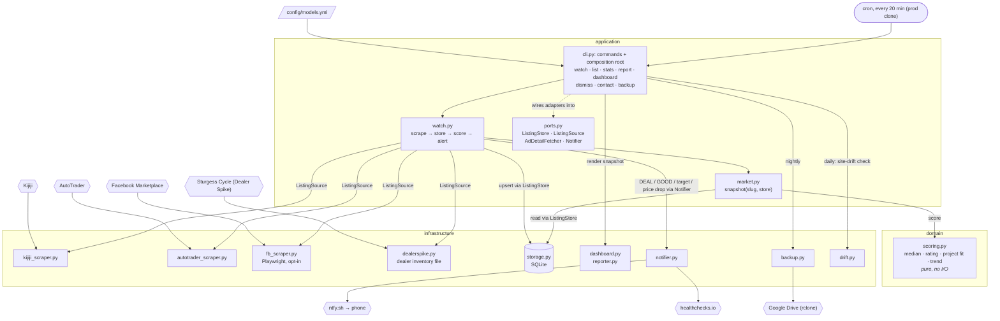

# dirtbike-tracker

Finds a **project bike** to wrench on with the kids: a used dirt bike that needs work, priced
right, with ownership. Scrapes Kijiji, AutoTrader, Facebook Marketplace and a dealer's used
inventory (Sturgess Cycle) for the models in `config/models.yml`,
stores listings in SQLite, rates each one against the model's 90-day market median, scores its
project fit, and pushes alerts to your phone via [ntfy](https://ntfy.sh).

## How it works



Every 20 minutes `watch` scrapes each model in `config/models.yml`, upserts listings into
SQLite, scores them via `snapshot()`, alerts on new DEAL/GOOD/target listings and on price
drops into GOOD/DEAL, and rebuilds `dashboard.html`. The domain layer is pure: it receives prices and
listings, never queries.

Ratings are price vs market median: **DEAL** ≤ -30%, **GOOD** ≤ -10%, **FAIR** ≤ +15%,
**HIGH** above that. A listing under a model's `target_price` alerts regardless of market.

**Private vs dealer (#81):** each listing records its seller type (Kijiji's "for sale by", AutoTrader's
seller). Once a model has 5 private sales in 90 days, its median is private sales only, shown as
"Median (private)": dealer asks run high, and a dealer posting on both sites counts twice. Dealer
listings are still shown and rated against that median, tagged `dealer`. A dealer's
current-model-year bike is treated as new/demo stock and skipped, like the sites' own "new" flags.

**Fit** (0-10, neutral 5) scores whether it's a good **project bike** to wrench on with kids, from
phrases in the title/description: +2 per green flag (`doesn't run`, `needs work`, `project`,
`ownership`, `trail`, ...), -3 per red flag (`no ownership`, `seized`, `blown`, `race bike`).
Needing work is the point; "runs great" is neutral. Lists live in `domain/scoring.py`. A listing
with fit below 5 never alerts, however cheap. The dashboard shows the Fit column only for `ride`
models: on project bikes it was 5 for 93% of ads (2026-10-24), so there it only gates alerts.

A model with `goal: ride` in `models.yml` (e.g. the Rebel 500, to ride in spring) flips that:
needing work, `no safety` and `sold as is` are red flags, and `runs great`, `safetied`,
`certified`, `low kms`, `new tires` are green. Ride models have no project-bike median.
Adding a model: an entry in `models.yml` (plus its slug in `KNOWN_MODEL_SLUGS`) with its
production years as `min_year` / `max_year` (a listing outside them is another bike or a typo:
a "2003 Honda crf" isn't a CRF250F; unknown years pass), and if
AutoTrader's keyword search misses the slug, a spelling in `autotrader_scraper.KEYWORDS`. If
AutoTrader files it under a model family ("Honda CRF"), add the family path to `FAMILY_PATHS`;
check the path first, since an unknown one silently returns the whole make page.
Run `dirtbike watch --group <group> --no-notify` once after deploying, or every listing
already on the market alerts as new.

Kijiji search pages carry a ~200-char snippet of every ad; a snippet that isn't cut off is the
whole ad. For a cut-off one that could alert (DEAL/GOOD or under target), `watch` reads the full
ad (up to 5 per model, once each) and re-scores fit on it. A red flag in the body stops the alert.

**Project bikes** (a condition phrase: `doesn't run`, `needs work`, `needs rings`, `project`, ...)
are rated against the median of other project bikes, since next to running bikes a non-runner
looks like a DEAL just for not running. Until a model has 5 project prices in 90 days they fall
back to the all-bikes median, shown as `vs all bikes*` (dashboard `-40%*`).

Layout is hexagonal (`src/dirtbike_tracker/{domain,infrastructure,application}`). See
[docs/architecture.md](docs/architecture.md) for modules, data model, dedup and scoring.

## Usage

```bash
dirtbike models                      # tracked models from config/models.yml
dirtbike watch                       # scrape all, score, notify, rebuild dashboard
dirtbike watch --no-notify --group priority
dirtbike scrape --model crf150f --source all
dirtbike list --model crf150f        # stored listings with ratings
dirtbike stats --model crf150f       # low / median / high / count
dirtbike report --model crf150f --write   # markdown snapshot to reports/
dirtbike dashboard --open
dirtbike dismiss <url-or-id>         # hide a listing you've evaluated (survives re-scrapes)
dirtbike undismiss <url-or-id>
dirtbike serve [--port 8765]          # the dashboard on localhost with its ✕ hide buttons working
dirtbike contact <url-or-id> --note "offered 750" [--on 2026-10-01]  # log messaging a seller (--clear to undo)
dirtbike backup [--slot weekly]      # DB + state to Google Drive (see Backups)
dirtbike drift [--replay] [--no-notify]   # site-drift check (see Site drift)
dirtbike fb-login                    # save a Facebook session, only if FB starts requiring one
```

Add or remove models in `config/models.yml`. Valid Kijiji slugs live in
`infrastructure/kijiji_scraper.py:KNOWN_MODEL_SLUGS`.

### Environment

| Var | Purpose |
|---|---|
| `NTFY_TOPIC` | ntfy topic to push alerts to. Required unless `--no-notify`. |
| `NTFY_STREET_TOPIC` | Optional second topic for the street, middleweight and dual-sport groups' alerts (`watch.STREET_GROUPS`), so street and dirt bikes can be muted separately. Unset: they go to `NTFY_TOPIC`. |
| `NTFY_SERVER` | Defaults to `https://ntfy.sh`. |
| `FB_CITY` | Facebook Marketplace city slug to search around. Defaults to `toronto`. |
| `FB_PROFILE_DIR` | Browser profile for the Facebook source. Defaults to `~/.config/dirtbike-tracker/fb-profile` (outside the repo). |
| `HEALTHCHECK_URL` | Optional. [healthchecks.io](https://healthchecks.io) ping URL hit after every completed `watch`; it alerts when pings stop. |

### Cron

Cron runs from a separate **prod clone** that stays on `main`, so a feature branch
checked out in the dev repo never goes live. The prod clone owns the live data: its own
`data/` (DB + notified state) and `dashboard.html`. The dev repo has a separate `data/`, so a
command run in dev (which runs `init_db()` and its schema migrations) never touches prod. To
work on fresh data in dev, copy prod's over between cron ticks:
`cp ~/Code/dirtbike-tracker-prod/data/listings.db ~/Code/dirtbike-tracker/data/`.

```bash
# one-time setup
git clone https://github.com/adamkwhite/dirtbike-tracker.git ~/Code/dirtbike-tracker-prod
cd ~/Code/dirtbike-tracker-prod
python3.13 -m venv venv && venv/bin/pip install -e .
NTFY_TOPIC=your-topic HEALTHCHECK_URL=https://hc-ping.com/<uuid> ./scripts/install_cron.sh   # every 20 min, 8am-11pm

# deploy after merging to main
git -C ~/Code/dirtbike-tracker-prod pull --ff-only

# uninstall
~/Code/dirtbike-tracker-prod/scripts/install_cron.sh --remove
```

`install_cron.sh` installs five jobs (Ontario time):

| When | Job | Log |
|---|---|---|
| every 20 min, 8:00–22:40 | `dirtbike watch` | `logs/watch.log` |
| 23:30 daily | `dirtbike report --model crf150f --write` | `logs/report.log` |
| 23:55 daily, 23:58 Sundays | `dirtbike backup` (nightly / `--slot weekly`) | `logs/backup.log` |
| 05:00 daily | `dirtbike drift` (see Site drift) | `logs/drift.log` |

Logs are in `~/Code/dirtbike-tracker-prod/logs/` (timestamped if `moreutils` is installed). After
changing the schedule in `install_cron.sh`, re-run it from the prod clone with the same
`NTFY_TOPIC` / `NTFY_STREET_TOPIC` / `HEALTHCHECK_URL` (and `FRIEND_NTFY_TOPIC`, below): it replaces every
`# dirtbike-tracker` line.

### A friend's watchlist

`config/friend.yml` is a second watchlist with its own alerts. It's personal, so it's
gitignored (every `config/*.yml` except `models.yml` is); start one from
`config/friend.example.yml`. `dirtbike --config config/friend.yml watch` shares the listings DB but keeps its own notified state
(`data/state/friend/`) and dashboard (`dashboard-friend.html`, local only). Set
`FRIEND_NTFY_TOPIC` when running `install_cron.sh` to add its watch at 9:10 every third day of the month
(offset from the main run), logging to `logs/watch-friend.log`; he subscribes to that topic in the ntfy app.
Seed it once with `--no-notify` like any new model.

Entries take extra fields for shopping new, specific bikes: `query` (search text when it isn't
the slug), `include_new` (keep dealer new stock), `min_year`, `require` (words the title must
name, e.g. `RS` drops the RX/RR) and `alert: all` (push every new match and every price drop,
not only deals). See the comments in `config/friend.example.yml`.

The main `dashboard.html` has a tab for each watchlist: **Dirt** (the `project` models), **Street**
(the `ride` models) and **Hoss** (`config/friend.yml`, read from the shared DB, so it fills in
whenever his watch runs). `dirtbike --config config/friend.yml dashboard --open` shows his bikes alone. Each tab's
make buttons (Honda, Yamaha, ...; every `models.yml` entry sets `make`) show only that brand's bikes. Its cc buttons (125, 150, 250, ...; an entry's `cc` is its size class) do the same by engine size, together with the make.

### Hiding bikes on the dashboard

Each row has a ✕. It asks for an optional note ("too far", "parts ad"), then moves the
listing to the **Hidden** section at the bottom of its tab, with an Unhide button. A hidden
listing stops alerting and stays hidden across re-scrapes, but still counts toward the market
median. `dismiss` is the stronger version for junk: never shown anywhere.

The **Notes** column holds your own notes on a bike ("asked for VIN", "Dad's friend knows him"):
click a cell to edit, empty clears it. Click a **Year** to set it when the ad has none or
gets it wrong (the VIN says 2004): yours is underlined and outlasts re-scrapes; empty hands it
back to the ad. The all-bikes table opens deals first; click a header to re-sort.

The buttons need `dirtbike serve`, which serves only the dashboard page (nothing else under the
project, so `data/` is never reachable) and saves hides to the DB, rebuilding the page. Run it
from the prod clone and bind it to localhost; reach it from your phone with `tailscale serve`.
Opened as a file, the page shows the buttons but can't save.

### Docker

An alternative to the WSL cron, e.g. for a VPS. `tracker` runs the same five jobs as
`install_cron.sh` via [supercronic](https://github.com/aptible/supercronic) (Ontario time, logs
to `docker compose logs`); `dashboard` serves the dashboard on `127.0.0.1:8080`.

```bash
mkdir -p data/state reports      # create first: docker makes missing bind dirs root-owned
printf 'NTFY_TOPIC=your-topic\nHEALTHCHECK_URL=https://hc-ping.com/<uuid>\n' > .env
docker compose up -d --build
```

Mounts `data/`, `reports/`, `config/` (read-only) and `~/.config/rclone` (override with
`RCLONE_CONFIG_DIR`). The image runs as uid 1000; build with `docker compose build --build-arg UID=$(id -u)` if
yours differs. Don't run it alongside the cron on the same `data/`: both would scrape.

### Backups

Cron runs `dirtbike backup` nightly at 23:55 (and `--slot weekly` on Sundays): a consistent
SQLite snapshot plus `data/state/`, uploaded to Google Drive via job-agent's `jobbackup` rclone
remote as `dirtbike-tracker-backups/{nightly,weekly}.tar.gz`. It refuses to upload a 0-row
snapshot, verifies the remote size, and pushes an ntfy alert on failure. Log: `logs/backup.log`.

```bash
# restore (run between cron ticks)
mkdir -p ~/dirtbike-restore
rclone cat jobbackup:dirtbike-tracker-backups/nightly.tar.gz | tar -xzf - -C ~/dirtbike-restore
python -c "import sqlite3, os; print(sqlite3.connect(os.path.expanduser('~/dirtbike-restore/listings.db')).execute('SELECT COUNT(*) FROM listings').fetchone())"
cp ~/dirtbike-restore/listings.db ~/Code/dirtbike-tracker/data/listings.db
cp ~/dirtbike-restore/state/* ~/Code/dirtbike-tracker/data/state/
```

Check the row count, not `PRAGMA quick_check`: quick_check passes on an empty file.

### Site drift

Kijiji and AutoTrader change their pages without notice. The source-health alert only fires
once a scraper has returned **nothing** for 24h; a field that quietly stops parsing (photos,
km, the new-stock filter) would go unnoticed. `dirtbike drift` catches that:

1. It records a few live pages into `tests/recorded/`: Kijiji searches for `crf150f` and
   `rebel500`, one Kijiji ad page, and an AutoTrader `rebel500` search (which has dealer stock).
2. It runs our real parsers over them and checks that listings parse with id, link, title and
   price state; that snippets, post dates, photos, year and km are read; that new dealer stock
   is skipped; and that the ad page's description reads. Logic: `infrastructure/drift.py`.
3. On any problem it prints them, pushes an ntfy alert ("Site drift: N parser problem(s)") and
   exits 1.

Cron runs it daily at 05:00, before the first watch, so a field that stops parsing is caught
within a day (the same window as the source-health alert); it's ~5 page fetches. An unfixed
problem alerts again each morning. The Docker crontab runs it too, recording into
`data/drift/` because `/app` isn't writable in the container.

**When it alerts:** read `logs/drift.log` for the list, open the recorded page next to the
parser named in the problem, fix the parser, then check the fix offline against the same pages
with `dirtbike drift --replay --no-notify`. Locally, `make drift` re-records and checks, and
`pytest tests/drift` runs the same check over whatever is recorded.

**Never commit `tests/recorded/`** (it's gitignored): the pages are third-party ads with private
sellers' names and phone numbers, and this repo is public. That's also why CI skips
`tests/drift`: there are no recordings there.

### Dealer inventory (Sturgess Cycle)

`infrastructure/dealerspike.py` (#99) reads a Dealer Spike dealer's inventory file: the site
renders its list client-side from `/imglib/Inventory/cache/<site id>/UVehInv.js` (used;
`VehInv.js` is everything), a `var Vehicles=[...]` literal with every unit. One plain GET per
watch run (cached across models), no browser, no paging; each model filters it by title.
Sturgess Cycle (Hamilton, site id 5620) is defined in `config/models.yml` under `dealers:`.
Every dealer lives there (platform, url, location, plus the platform's own settings), so a new
dealer on a platform we already read (`dealerspike`, `escsite`, `focus`; `cli.PLATFORMS`) is a
config block, no code. A dealer on another platform needs an adapter first.

Every unit is dealer stock (`seller_type = dealer`, so it stays out of the private-sales
median), and new units plus a dealer's current-model-year bikes are skipped unless a model sets
`include_new`. A model with none at the dealer is normal: a fetch that worked counts as "seen",
so unmatched listings age out as sold and source health only alerts if the fetch itself keeps
failing. The drift check records the file daily.

### Facebook Marketplace

An optional third source (#9). Marketplace is a React app, so a real browser (Playwright +
Chromium) loads the search page and `infrastructure/fb_scraper.py` parses the rendered cards:
price, title, location, year (from the title), km when shown, photo. **Logged-out search works**
(FB draws a login overlay over real results), so no account is needed to start.

It adds real inventory: the first CRF150F search (2026-10-12) found 14 listings, about 10 of
them not on Kijiji or AutoTrader.

Logged out, a search returns only ~12 cards (scrolling loads no more), so each one is a sample.
Searches alternate between the slug and its spaced form (`klx140`, then `klx 140`: they shared
only 7 of 12 cards, 2026-10-27), and a Facebook ad counts as gone after 7 days unseen
(`storage.SAMPLED_SOURCE_HOURS`), not the 2 days Kijiji and AutoTrader get.

**Setup** (in the checkout that runs it; the prod clone for cron):

```bash
venv/bin/pip install -e '.[fb]'                  # playwright
venv/bin/python -m playwright install chromium   # ~115 MB, into ~/.cache/ms-playwright
```

**Turn it on per model** by adding `facebook` to its `sources` in `config/models.yml`, then run
`dirtbike watch --group <group> --no-notify` once after deploying, or every bike already on FB
alerts as new. `dirtbike scrape --model crf150f --source facebook` tries one model by hand.

**Login, only if FB starts requiring it:** `dirtbike fb-login` opens a visible browser (WSLg on
Windows 11) on the FB login page; log in, close the window, and the session stays in
`FB_PROFILE_DIR`. Use a dedicated account if you can: automated access is against FB's terms
and the account doing it can be rate-limited or locked. The profile is a logged-in session:
never copy it into the repo.

**Limits:**
- Each model is searched at most once every 6 hours (`fb_scraper.MIN_INTERVAL`; times in
  `data/state/fb_searches.json`), so FB sees ~4 searches a day per model, not one every 20 min.
- A failed or blocked search returns nothing and retries next run; if FB returns nothing for
  24h, the source-health alert fires.
- FB titles are often vague ("2003 Honda crf"). They're kept, since FB's search matched them on
  the model; titles naming a different known model (e.g. CRF150R) are dropped.
- No full ad text yet (fit scores on the title only), and FB cross-posts of Kijiji ads aren't
  merged (titles and locations differ).
- Not in the Docker image (no browser there).

## Requirements

- Python 3.13+

## Development

### 1. Install Dependencies

```bash
# Create and activate virtual environment
python3.13 -m venv venv
source venv/bin/activate  # On Windows: venv\Scripts\activate

# Install project dependencies
pip install -r requirements.txt

# Install development dependencies
pip install -e ".[dev]"
```

### 2. Set Up Pre-commit Hooks (Required)

Pre-commit hooks automatically format and lint your code before each commit, ensuring code quality.

```bash
# Install pre-commit
pip install pre-commit

# Enable pre-commit hooks
pre-commit install

# (Optional) Run against all files to test
pre-commit run --all-files
```

**What pre-commit does:**
- Auto-fixes formatting issues with Ruff
- Sorts imports automatically
- Removes trailing whitespace
- Validates YAML/JSON files
- Type checks with mypy
- Security scans with Bandit

**Your workflow:**
1. Write code (Claude or manual)
2. Run `git commit`
3. Pre-commit auto-fixes formatting
4. Commit succeeds with clean code

### 3. Tests

```bash
pytest tests/ --cov=src
```

CI runs pre-commit, pytest and SonarCloud on every push and PR.

### Exception Handling & `noqa` Conventions

Ruff enforces `BLE` (blind-except), `TRY` (tryceratops), `LOG`, and `G` (logging-format) rules. Broad `except Exception` blocks fail CI by default.

When a broad catch is intentional and the handler logs or re-raises, suppress with a plain noqa:

```python
except Exception:  # noqa: BLE001
    logger.exception("failed to process item")
```

When the broad catch is real debt that swallows silently, tag it as a FIXME:

```python
except Exception:  # noqa: BLE001  # FIXME: blind catch, tighten + log
    pass
```

Grep the FIXME tag to get the live backlog count:

```bash
grep -rn 'FIXME: blind catch' src/
```

Do not add blanket per-file `BLE` ignores for whole directories. Each suppression is inline so a real silent swallow can't hide behind a directory-wide glob.
